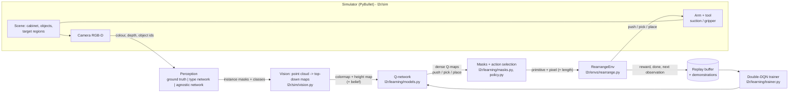
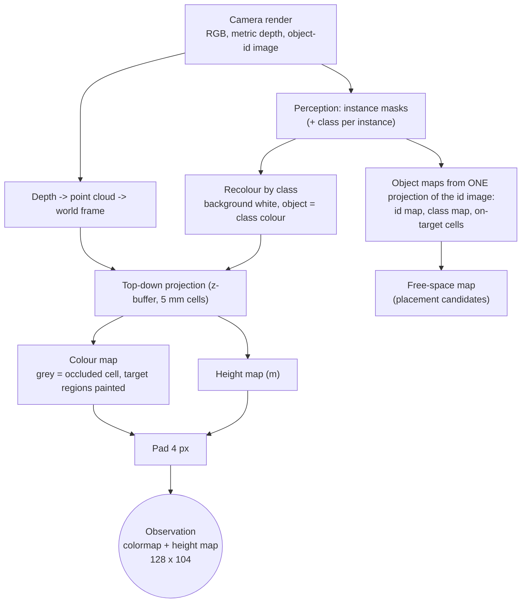
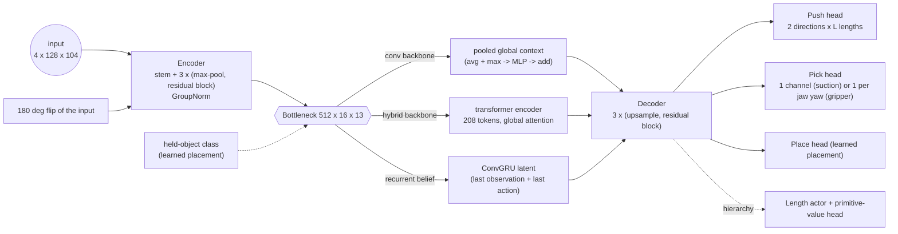
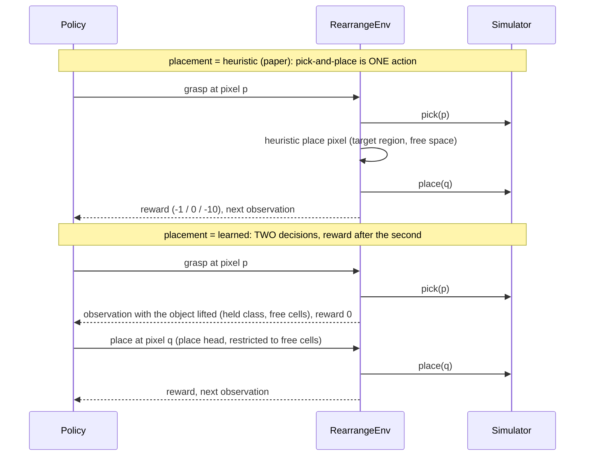
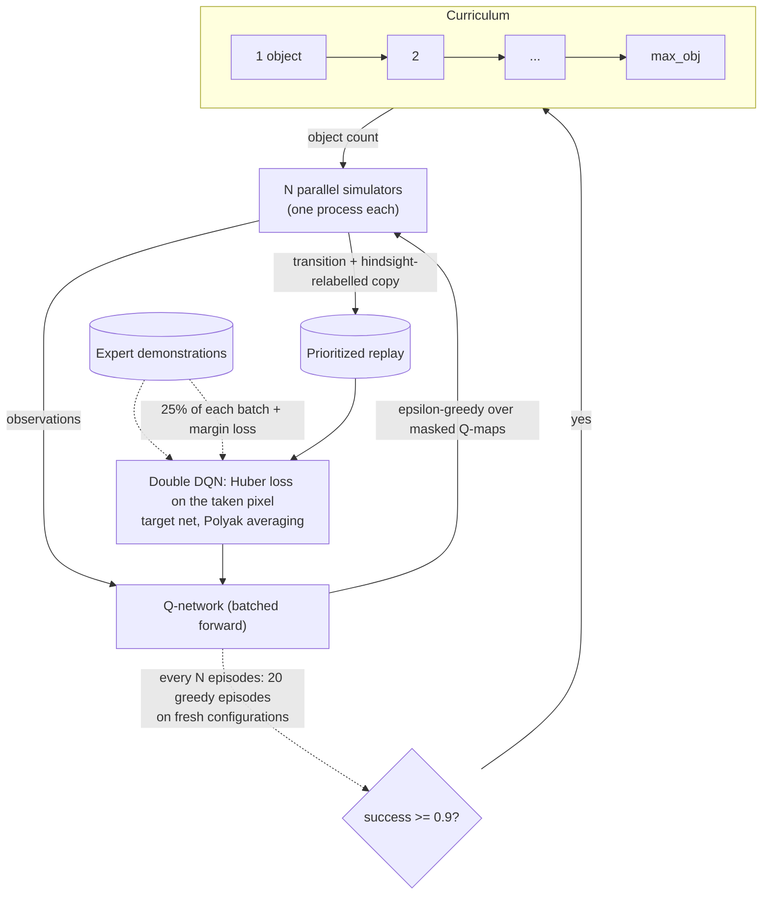
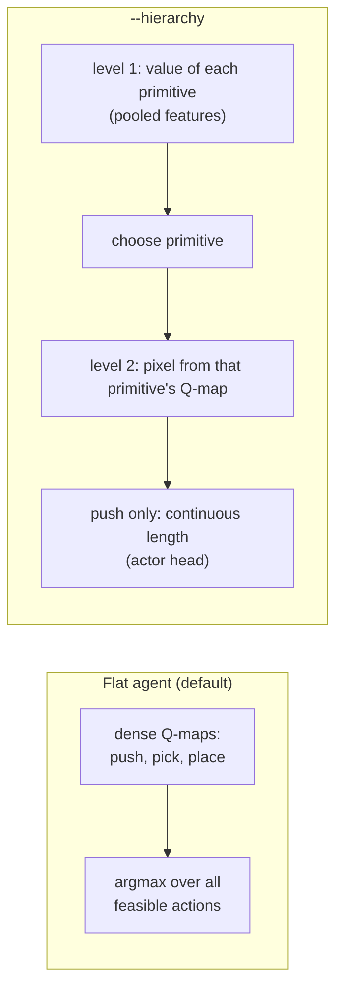
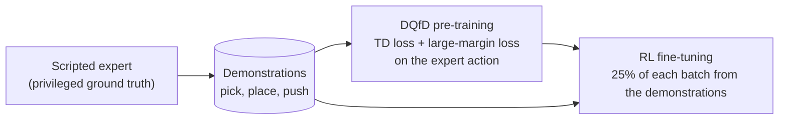

# Learning to Rearrange Objects in Confined Environments

A robot arm sorts objects inside a cabinet it can only reach from the front. It sees the cabinet from one RGB-D camera, and chooses
between **pushing** (a blade) and **pick-and-place** (a suction cup or a parallel-jaw gripper) at every step. The policy is a
fully convolutional network that outputs a dense Q-map over the top-down map of the cabinet, trained with double deep Q-learning in a
PyBullet simulation. Project page: <https://alessandropalleschi.github.io/Learning2Rearrange/>

The repository started as the code of the paper and is now a research platform around it: every extension is an opt-in flag, so the
paper's method is one configuration among several. **Nothing here has been trained to convergence; the numbers in the docs measure mechanics (speed, signals, expert
success, mask effects), not final success rates.** See [Status](#status).

| document | content |
|---|---|
| this file | what the code does, how it is organised, the variants and how to run them |
| [`ABLATIONS.md`](ABLATIONS.md) | what each flag changes, why, and what was decided |
| [`SIMULATION_NOTES.md`](SIMULATION_NOTES.md) | review of the simulator, rendering and networks: bugs fixed, measurements, open issues |
| [`ISAAC_MIGRATION.md`](ISAAC_MIGRATION.md) | how a move to Isaac Sim / Lab would work (a plan, not measured) |

## Contents
1. [Quick start](#quick-start)
2. [The task and the pipeline](#the-task-and-the-pipeline)
3. [Code layout](#code-layout)
4. [Observation processing](#observation-processing)
5. [The network](#the-network)
6. [Actions and primitives](#actions-and-primitives)
7. [Training](#training)
8. [Variants](#variants)
9. [Tools and experiments](#tools-and-experiments)
10. [Status](#status)

---

## Quick start

**Dev container (recommended).** Install Docker and the VS Code *Dev Containers* extension (or use Codespaces); for GPU training also the
NVIDIA Container Toolkit (without a GPU delete `"--gpus=all"` from `.devcontainer/devcontainer.json`; training then runs on the CPU, slowly).
"Reopen in Container", then:

```bash
pytest -q                                     # unit + pipeline tests (no PyBullet needed for most)
python train.py --num_envs 8 --max_obj 5      # headless training, curriculum 1 -> 5 objects
python evaluate.py --snapshot logs/train/models/snapshot-0010000.pth --objects 3 4 5 --episodes 20 --num_envs 4
xvfb-run -a python train.py --gui             # PyBullet GUI inside the container (virtual display)
```

Without a container: `pip install torch` (CUDA build for a GPU) and `pip install -r requirements.txt`.
Logs go to `logs/<logging_directory>/` (`episodes.csv`, `validation.csv`, TensorBoard in `tb/`, snapshots in `models/`).

The flags that define the **model and agent** (`--belief`, `--placement`, `--backbone`, `--hierarchy`, `--push_lengths`, `--mask_level`,
`--end_effector`, ...) must be identical for training and `evaluate.py`; `python train.py --help` lists everything.

---

## The task and the pipeline

Objects of three classes (blue / green / yellow) stand on the floor of a cabinet; each class has a **target region** (a band across the
cabinet width). The episode ends when every object is inside the region of its class (goal), an object falls or topples (invalid), or
the action budget is used up. The robot reaches in from the front only, so objects hide behind each other.



`RearrangeEnv` is the Gym-style boundary (`reset`, `step`): it executes the chosen primitive in the simulator, computes the reward, detects the
end of the episode, produces the next observation and the **hindsight relabelling** (a state where every object sits in *some* region is
turned into a sorted state by reassigning the classes). The simulator behind it is replaceable: `l2r/sim/backend.py` lists the
~15 calls the learning code needs (see [`ISAAC_MIGRATION.md`](ISAAC_MIGRATION.md)).

---

## Code layout

```
train.py  evaluate.py  profile_sim.py  analyze_rewards.py  train_perception.py  demo_sim.py     thin entry points
scripts/   run_experiments.py (suites, seeds, summaries)  collect_demos.py  speed_ablation.py
l2r/
  config.py          Config (learning, agent variants) and SimParams (physics, controller, camera, presets); all CLI flags
  training.py        TrainingLoop + Curriculum: parallel simulators, replay, relabelling, validation-based curriculum, snapshots
  evaluation.py      fixed-seed greedy evaluation per object count
  demos.py           scripted expert and demonstration recording (DQfD data)
  profiling.py  reward_analysis.py  logger.py  utils.py
  envs/
    rearrange.py     RearrangeEnv: action execution, reward variants, termination, relabelling, placement helpers
    vec.py           parallel simulators in worker processes
  learning/
    models.py        QNet: encoder-decoder, bottleneck (global context | transformer | ConvGRU), push/pick/place heads, hierarchy
    trainer.py       batched double DQN: prioritized replay, Huber loss on the taken pixel, DQfD margin loss, mixed precision
    policy.py        epsilon-greedy / hierarchical action selection, recurrent-belief bookkeeping
    masks.py         structural action masks (front-face grasps, blade-strip pushes)
    belief.py        spatial belief tracker (memory map)
    memory.py        uniform and prioritized replay
  perception/
    base.py          Perception interface: ground truth | network (Segmentation: instances, names, privileged id match)
    unet.py network.py agnostic.py training.py     type U-Net, object-agnostic U-Net, data collection / training / evaluation
  sim/
    environment.py   Environment: wires the parts below to one PyBullet client (injectable for tests)
    backend.py       SimBackend: the simulator boundary used by the learning code
    workspace.py     cabinet bounds, heightmap grid, pixel <-> metre conversions (no global state)
    scene.py         cabinet, objects, target regions, goal and invalid-state checks
    camera.py vision.py       RGB-D rendering; point cloud -> top-down maps, object maps, free-space map (pure numpy)
    arm.py arm_control.py force_sensing.py     UR5e: joint control (legacy / rate-limited), IK, straight moves, force-limit stop
    suction.py gripper.py primitives.py        suction cup (constraint model), parallel-jaw gripper, push / pick / place
    constants.py     classes, colours, object catalogue, target-region candidates
tests/               pytest: components against fakes, learning, pipeline with a fake simulator, real-simulator tests + regression
```

---

## Observation processing

The policy never sees the camera image directly: it sees a **top-down map of the cabinet** in which every object is recoloured by its
class, so appearance (texture, lighting, object shape) is abstracted away.



* The network input has **4 channels** (RGB colour map + height map), or 11 with the spatial belief.
* Occluded cells are marked grey inside the colour channels (the camera sees the cabinet from the front, so everything behind an
  object is unobserved).
* With a learned perception, instances are split into connected pieces **in the top view** (objects that overlap in the image
  separate in 3D). Ground truth then survives only as *privileged* information for the learning signals that need it
  (hindsight relabelling, the belief's id memory) and never as policy input.
* The replay buffer stores compact observations only (colour map, height map, belief): a few hundred KB instead of the raw images.

---

## The network

One shared fully convolutional backbone with a dense head per primitive. The second push direction is the same head applied to the
input rotated by 180 degrees (an exact flip), so the network needs no learned rotation.



| variant | change |
|---|---|
| `--backbone conv` (default) | global context by pooling at the bottleneck |
| `--backbone hybrid` | transformer encoder on the 1/8-resolution bottleneck; zero-initialised output, so it starts as the conv network (+0.75 M parameters, +3 ms) |
| `--belief recurrent` | ConvGRU at the bottleneck |

Why a hybrid and not Swin or a plain ViT: see [`ABLATIONS.md`](ABLATIONS.md). The network runs at the maps' native 128 x 104 size
(no padding to a square canvas); the place head is only built when placement is learned.

---

## Actions and primitives

| primitive | action (pixel in the Q-map) | execution |
|---|---|---|
| **push** | `(direction x length index, row, col)`: start of the blade, direction left / right | blade 5 cm above the floor goes in, pushes 8 cm along the cabinet width, retreats |
| **pick** | `(row, col)` (suction) or `(jaw yaw, row, col)` (gripper) | approach from the front until contact, vacuum on / jaws close, lift out |
| **place** | free-space pixel | carry the object to the cell, release, retreat |



The pick is bootstrapped from the best place value without discount (one pick-and-place counts as one decision). Pushing is not a "fallback":
it exposes occluded objects, moves several objects at once and finishes objects that are one push from their region.

---

## Training



* **Reward** (paper): -1 per action, 0 on the goal, -10 for an invalid state; variants below.
* **Exploration**: epsilon-greedy, 0.8 annealed to 0.01 per curriculum stage, over the *masked* maps.
* **Curriculum**: the object count grows when the recent success rate is high. The default rule uses the epsilon-greedy training window
  (as in the paper); `--curriculum_eval 20` instead advances only after a **greedy validation** on 20 fresh random configurations.
  `--stage_mix p` draws earlier stages with probability p to keep easy states in the buffer.
* **Hindsight relabelling** recolours both observations of the transition with the post-hoc class assignment and gives it the goal reward.
* Parallel simulation is the bottleneck (about 1 action/s per process); `--adaptive_step --joint_tolerance 3e-3` cuts the physics steps per
  action by ~2.4x with the same executed fraction (`scripts/speed_ablation.py`).

---

## Variants

Every variant is a flag; they combine. The baseline of the experiment runner is `--placement learned --footprint_placement`.

### Agent and architecture
| flag | variant | what it is |
|---|---|---|
| `--belief none\|spatial\|recurrent` | belief state | memoryless (paper) / a memory map of what was seen (last colour, height, age, last action; +7 input channels) / a ConvGRU latent updated from the encoded observation and action |
| `--placement heuristic\|learned` | placement | rule from the paper / a place head over free cells, conditioned on the held class |
| `--push_lengths 0.04 0.08 0.12` | learned push length | one Q-map per (direction, length) |
| `--hierarchy` | hierarchical agent | level 1 picks the primitive from pooled features; level 2 the pixel and, for pushes, a **continuous length** (DDPG-style actor on a length-conditioned critic) |
| `--backbone hybrid` | transformer | see [The network](#the-network) |
| `--end_effector suction\|gripper` | tool | suction cup (constraint model) / wide-stroke parallel-jaw gripper (friction, one Q channel per jaw yaw, `--jaw_yaws`) |



### Observation and perception
| flag | variant |
|---|---|
| `--perception gt` | masks from PyBullet's ground truth |
| `--perception network` | a small U-Net predicts the object **type**; the episode's type -> class specification gives the class (0.96 pixel IoU, top-view instance recall 0.97 on unseen scenes) |
| `--perception agnostic` | an **object-agnostic** U-Net (background / interior / touching-boundary, no type catalogue); instances are connected components of the interior, so it should transfer to unseen object types (`--object_types` holds types out) |

An object's class is part of the task (its target region), not of its appearance, which is why the type network needs the episode specification.
Train and evaluate: `python train_perception.py collect|train|evaluate [--task agnostic]`.

### Rewards, masks, placement
| flag | variant |
|---|---|
| `--reward_mode sparse` | the paper's reward |
| `--reward_mode progress\|distance` | potential-based shaping (policy-invariant) by sorted fraction / by distance to the target region |
| `--reward_mode noop` | sparse + a penalty for actions that moved nothing (changes the optimum) |
| `--mask_level basic` | grasp on any object cell, push near objects (original) |
| `--mask_level structured` | grasp only just inside an object's **front face**, push only with an object in the **blade's own strip**: 703 -> 193 grasp cells per scene; a random push moves an object 88% of the time instead of 62% |
| `--footprint_placement` | keep the placement target clear of the back wall by the held object's depth |
| `--placement_space region` | additionally fit the object's whole footprint and offer only cells inside its own target region |

### Demonstrations (imitation initialisation, then RL)

The expert picks the front-most misplaced object (aiming a few millimetres *inside* it: the cup stops on contact and a front-most
aim often misses), places it by the footprint-aware heuristic, pushes objects that are one push from their region, and pushes a front
object aside when every misplaced object is hidden. A margin loss keeps the network a **Q**-network (plain behaviour-cloning logits
would not be Q-values); a generative policy (diffusion / ACT) is not used: a dense pixel map already represents several equally good picks as several peaks.
`python scripts/collect_demos.py ...` records them, `python train.py --demos data/demos/expert.pkl --pretrain_steps 3000` uses them.

### Simulator
| flag | variant |
|---|---|
| `--sim_quality legacy\|improved\|modern` | IK with joint limits, tared / filtered force contact detection, verified suction grasps; `modern` adds a rate-limited joint controller, more solver iterations, deterministic contacts |
| `--physics paper` | the paper's cabinet dimensions, weaker suction, lighter objects (unvalidated) |
| `--adaptive_step`, `--joint_tolerance`, `--camera_scale`, `--step_distance` | speed options (measured in `SIMULATION_NOTES.md`) |
| `--randomize` | domain randomisation (friction, mass, camera pose, sensor noise) |

---

## Tools and experiments

| tool | use |
|---|---|
| `scripts/run_experiments.py list\|run\|summarize` | named suites (`core`, `belief`, `perception`, `end_effector`, `physics`, `smoke`) x seeds -> `summary.md`; `--max_obj`, `--num_obj`, `--max_episodes`, `--extra <train flags>` |
| `evaluate.py` | greedy evaluation on fixed seeds per object count (success rate, mean actions, return) |
| `profile_sim.py` | where the simulation time goes, executed / attempted actions, force-limit stops |
| `analyze_rewards.py` | the reward signal and scene volatility under random actions |
| `scripts/speed_ablation.py` | physics steps per action and executed fraction for the speed options |
| `scripts/collect_demos.py` | record expert demonstrations |
| `tests/sim_scenario.py record\|check` | deterministic scripted scenario on the real simulator (golden results for refactoring) |

Tests: `pytest -q` (the real-simulator regression runs with `L2R_GOLDEN=1`); lint: `ruff check .`.

---

## Status

* **Established (measured in simulation):** simulator and observation pipeline work and are tested; observation 358 -> 252 ms and network
  inference/training 1.8-2.7x faster than the first version; perception networks work on unseen scenes; the scripted expert sorts 93 / 87 / 87 / 73 % of
  scenes with 2 / 3 / 4 / 5 objects with the default placement (93 / 93 / 93 / 53 % with `--placement_space region`; 15 episodes each, about +-10 points of noise); structured masks raise the share of random pushes that move an object from 62 % to 88 %.
* **Not yet established:** whether any learned variant reaches a high success rate at 3-5 objects. From scratch, the baseline reached 3 objects only after about
  4,800 steps under the greedy-validation curriculum (it started at 1). The demonstration-initialised runs (with and without structured masks) are the first comparison.
* **Known limits:** the expert is pick-and-place first and pushes only in the situations listed above; the footprint-aware region placement
  helps at 3-4 objects but not (yet) at 5; the suction fallback path is effectively dead for front-face grasps; PyBullet is slow (a move to Isaac
  is kept open in [`ISAAC_MIGRATION.md`](ISAAC_MIGRATION.md)).

Snapshots saved by older versions of this code are not compatible with the current networks.
