# Learning to Rearrange Objects in Confined Environments

A robot arm sorts objects inside a cabinet it can only reach from the front. It sees the cabinet from one RGB-D camera, and chooses
between **pushing** (a blade) and **pick-and-place** (a suction cup or a parallel-jaw gripper) at every step. The policy is a
fully convolutional network that outputs a dense Q-map over the top-down map of the cabinet, trained with double deep Q-learning in a
PyBullet simulation. Project page: <https://alessandropalleschi.github.io/Learning2Rearrange/>

The repository started as the code of the paper and is now a research platform around it: every extension is an opt-in flag, so the
paper's method is one configuration among several. **Nothing here has been trained to convergence; the numbers in the docs measure mechanics (speed, signals, expert
success, mask effects, imitation, RL plateaus and their causes), not final success rates.** See [Status and results](#status-and-results).

| document | content |
|---|---|
| this file | what the code does, how it is organised, the variants and how to run them |
| [`ABLATIONS.md`](ABLATIONS.md) | what each flag changes, why, and what was decided |
| [`SIMULATION_NOTES.md`](SIMULATION_NOTES.md) | review of the simulator, rendering and networks: bugs fixed, measurements, open issues |
| [`ISAAC_MIGRATION.md`](ISAAC_MIGRATION.md) | how a move to Isaac Sim / Lab would work (a plan, not measured) |

## Contents
1. [Quick start](#quick-start)
2. [The task and the pipeline](#the-task-and-the-pipeline)
3. [Code layout](#code-layout)
4. [Observation processing](#observation-processing)
5. [The agents and networks](#the-agents-and-networks)
6. [Actions and primitives](#actions-and-primitives)
7. [Training](#training)
8. [Variants](#variants)
9. [Tools and experiments](#tools-and-experiments)
10. [Status and results](#status-and-results)

---

## Quick start

**Dev container (recommended).** Install Docker and the VS Code *Dev Containers* extension (or use Codespaces); for GPU training also the
NVIDIA Container Toolkit (without a GPU delete `"--gpus=all"` from `.devcontainer/devcontainer.json`; training then runs on the CPU, slowly).
"Reopen in Container", then:

```bash
pytest -q                                     # unit + pipeline tests (no PyBullet needed for most)
python train.py --num_envs 8 --max_obj 5      # headless training, curriculum 1 -> 5 objects
python evaluate.py --snapshot logs/train/models/snapshot-0010000.pth --objects 3 4 5 --episodes 20 --num_envs 4
xvfb-run -a python train.py --gui             # PyBullet GUI inside the container (virtual display)
```

Model checkpoints (`*.pth`, e.g. the perception networks in `assets/perception/`) are stored with **Git LFS**: run `git lfs install && git lfs pull`
after cloning (the dev container has it installed).

Without a container: `pip install torch` (CUDA build for a GPU) and `pip install -r requirements.txt`.
Logs go to `logs/<logging_directory>/` (`episodes.csv`, `validation.csv`, TensorBoard in `tb/`, snapshots in `models/`).

The flags that define the **model and agent** (`--belief`, `--placement`, `--backbone`, `--hierarchy`, `--push_lengths`, `--mask_level`,
`--end_effector`, ...) must be identical for training and `evaluate.py`; `python train.py --help` lists everything.

---

## The task and the pipeline

Objects of three classes (blue / green / yellow) stand on the floor of a cabinet; each class has a **target region** (a band across the
cabinet width). The episode ends when every object is inside the region of its class (goal), an object falls or topples (invalid), or
the action budget is used up. The robot reaches in from the front only, so objects hide behind each other.

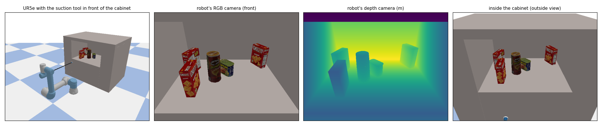
*The UR5e with the suction tool in front of the cabinet, the robot's own RGB-D camera, and a view into the cabinet. YCB objects (cracker
boxes, chips cans, meat cans, mustard bottles) are assigned to the three classes per episode.*

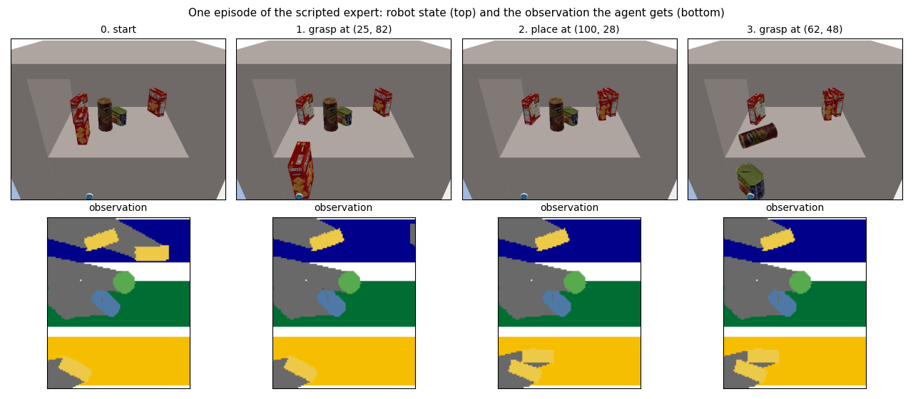
*Robot state (top) and the observation the agent receives (bottom) along an episode of the scripted expert with learned placement:
a grasp lifts the object (the observation then shows the scene without it), the place puts it into its region. In step 3 the grasp
tips the chips can over: the episode ends as invalid, the most common failure with many objects.*

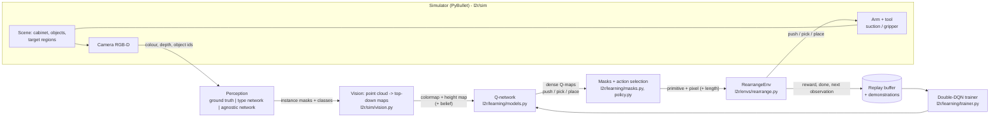

`RearrangeEnv` is the Gym-style boundary (`reset`, `step`): it executes the chosen primitive in the simulator, computes the reward, detects the
end of the episode, produces the next observation and the **hindsight relabelling** (a state where every object sits in *some* region is
turned into a sorted state by reassigning the classes). The simulator behind it is replaceable: `l2r/sim/backend.py` lists the
~15 calls the learning code needs (see [`ISAAC_MIGRATION.md`](ISAAC_MIGRATION.md)).

---

## Code layout

```
train.py  evaluate.py  profile_sim.py  analyze_rewards.py  train_perception.py  demo_sim.py     thin entry points
scripts/   run_experiments.py (suites, seeds, summaries)  collect_demos.py  merge_demos.py  speed_ablation.py  grasp_profile.py
           arch_benchmark.py (supervised architecture benchmark)  dagger.py (DAgger with the scripted expert)
l2r/
  config.py          Config (learning, agent variants) and SimParams (physics, controller, camera, presets); all CLI flags
  training.py        TrainingLoop + Curriculum: parallel simulators, replay, relabelling, validation-based curriculum, snapshots
  evaluation.py      fixed-seed greedy evaluation per object count
  demos.py           scripted expert, demonstration recording, demo adaptation (push-length encoding, belief stripping)
  arch_benchmark.py  network variants trained on demonstrations (cross-entropy), held-out metrics, closed-loop rollouts
  dagger.py          DAgger: learner drives, expert labels the visited states, aggregate, retrain
  profiling.py  reward_analysis.py  logger.py  utils.py
  envs/
    rearrange.py     RearrangeEnv: action execution, reward variants, termination, relabelling, placement helpers, outcome record
    approach.py      collision-aware approach lines and placement corridors from the height map
    vec.py           parallel simulators in worker processes
  learning/
    factory.py       make_trainer(cfg): the agent by --agent (dense | object | policy_critic)
    models.py        dense QNet: encoders (residual | ConvNeXt | ResNet-18), decoders (plain | U-Net | FPN | attention | HRNet),
                     bottleneck context (global | transformer | PPM | ASPP | ConvGRU), push/pick/place heads, hierarchy
    trainer.py       batched double DQN: prioritized replay, Huber loss on the taken pixel, DQfD margin loss, demo annealing, AMP
    object_centric.py  object-centric agent: instances / ghosts / place candidates from the observation, token transformer
    object_trainer.py  double DQN over object-action slots and place candidates (same interface as the dense trainer)
    policy_critic.py   policy heatmaps trained by behaviour cloning + Q critic over their top-K proposals
    iql_trainer.py     IQL for the object agent (expectile value, advantage-weighted policy)
    skill_params.py    parameterised skills (approach, heading, length) with a flow-matching parameter policy
    nstep.py           n-step returns for the replay
    policy.py        epsilon-greedy / hierarchical action selection, recurrent-belief bookkeeping
    masks.py         structural action masks (front-face grasps, blade-strip pushes)
    belief.py        spatial belief tracker (memory map)
    memory.py        uniform and prioritized replay
  perception/
    base.py          Perception interface: ground truth | network (Segmentation: instances, names, privileged id match)
    unet.py network.py agnostic.py training.py     type U-Net, object-agnostic U-Net, data collection / training / evaluation
  sim/
    environment.py   Environment: wires the parts below to one PyBullet client (injectable for tests)
    backend.py       SimBackend: the simulator boundary used by the learning code
    workspace.py     cabinet bounds, heightmap grid, pixel <-> metre conversions (no global state)
    scene.py         cabinet, objects, target regions, goal and invalid-state checks
    camera.py vision.py       RGB-D rendering; point cloud -> top-down maps, object maps, free-space map (pure numpy)
    arm.py arm_control.py force_sensing.py     UR5e: joint control (legacy / rate-limited), IK, straight moves, force-limit stop
    suction.py gripper.py primitives.py        suction cup (constraint model), parallel-jaw gripper, push / pick / place
    constants.py     classes, colours, object catalogue, target-region candidates
tests/               pytest: components against fakes, learning, pipeline with a fake simulator, real-simulator tests + regression
```

---

## Observation processing

The policy never sees the camera image directly: it sees a **top-down map of the cabinet** in which every object is recoloured by its
class, so appearance (texture, lighting, object shape) is abstracted away.

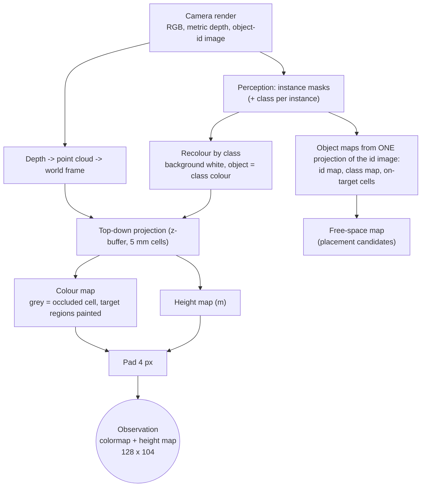

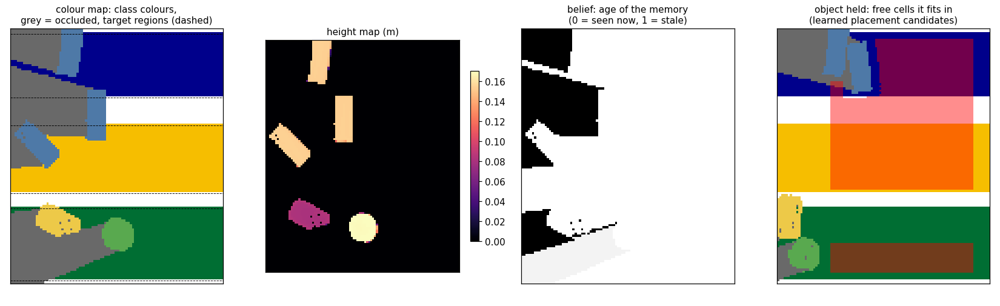
*The observation: colour map (class colours, grey = occluded cells, target regions as coloured bands), height map, the age channel
of the spatial belief, and, while an object is held, the free cells it fits in (the learned placement's candidates).*

* The network input has **4 channels** (RGB colour map + height map), or 11 with the spatial belief.
* Occluded cells are marked grey inside the colour channels (the camera sees the cabinet from the front, so everything behind an
  object is unobserved).
* With a learned perception, instances are split into connected pieces **in the top view** (objects that overlap in the image
  separate in 3D). Ground truth then survives only as *privileged* information for the learning signals that need it
  (hindsight relabelling, the belief's id memory) and never as policy input.
* The replay buffer stores compact observations only (colour map, height map, belief): a few hundred KB instead of the raw images.

---

## The agents and networks

Three agents share the environment, the replay, the curriculum and the trainer interface (`--agent`, built by
`l2r/learning/factory.py`): every agent returns the same dense Q-maps, so action selection, masks and evaluation are common code.

| `--agent` | decides over | network |
|---|---|---|
| `dense` (default, paper) | every pixel of the push / pick / place maps | fully convolutional encoder-decoder |
| `object` | (visible object, skill) slots + place candidates | transformer over object tokens |
| `policy_critic` | top-K cells of learned policy heatmaps, ranked by the Q critic | dense network with policy heads |

### Dense Q-network (`--agent dense`)

One shared fully convolutional backbone with a dense head per primitive. The second push direction is the same head applied to the
input rotated by 180 degrees (an exact flip), so the network needs no learned rotation. Encoder, bottleneck context and decoder are
interchangeable:

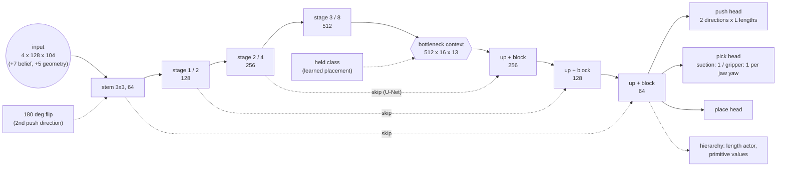

| part | flag | options |
|---|---|---|
| encoder blocks | `--arch_encoder` | `resnet` (residual 3x3, GroupNorm), `convnext` (7x7 depthwise ConvNeXt blocks), `resnet18_imagenet` / `resnet18_scratch` (torchvision stages) |
| decoder | `--arch_decoder`, `--arch_skips` | `plain` (paper: no skips), `unet` (skips), `fpn`, `attn_unet` (attention-gated skips), `unet_attn4` (+ global attention at 1/4), `hrnet` (parallel resolutions) |
| bottleneck context | `--backbone` | `conv` (pooled global context), `hybrid` (transformer, 208 tokens), `ppm` (pyramid pooling 1/2/4), `aspp` (dilations 1/2/4 + global pool), `ppm_aspp` |
| bottleneck size | `--arch_stride4` | bottleneck at 1/4 instead of 1/8 resolution (U-Net decoders) |
| memory | `--belief recurrent` | ConvGRU at the bottleneck, from the encoded observation and the last action |

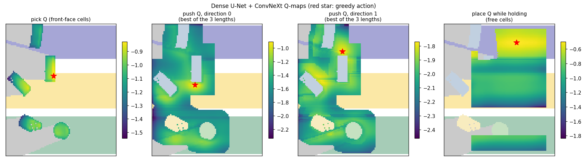
*Q-maps of the dense U-Net + ConvNeXt agent (RL with the curriculum, 5,000 steps, still training) on one scene with five objects.
Q-values are shown only on feasible cells: pick on the objects' front faces, push from cells whose blade path meets an object (best of
the three lengths per cell; the arrow is the greedy push and its length), place on the free cells the held object fits in. The coloured
bars on the left are the target regions; light grey is occluded. The greedy action pushes the blue object standing in the yellow region
up into the blue one.*

The context modules start as the identity (zero-initialised residual output). Which combination works best is measured in
[Status and results](#status-and-results): the U-Net decoder with the ConvNeXt encoder (`--arch_skips --arch_encoder convnext`).

### Object-centric agent (`--agent object`)

The scene is described by tokens extracted from the observation alone (no privileged ids): one per visible object (a connected piece
of one class colour on raised cells), one per remembered but hidden object (from the spatial belief), one per target region and one
global token. A transformer contextualises them; each object token gets a value per skill. Candidate pixels are geometric: a grasp just
inside the object's front face, a push with the blade beside the object.

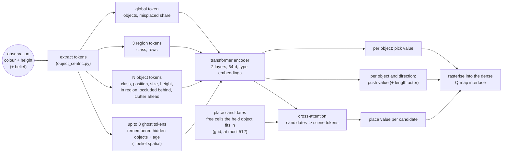

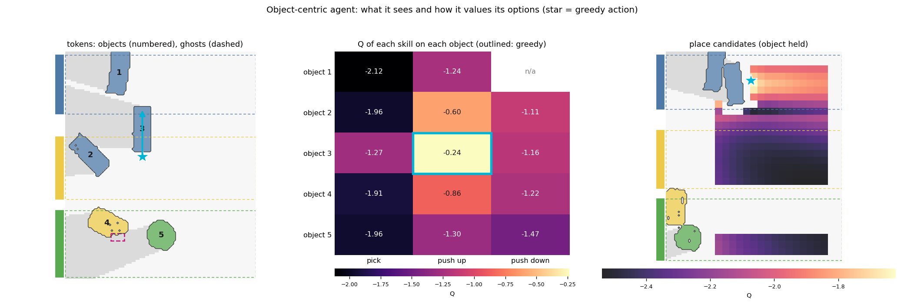
*The object-centric agent (RL, 8,000 steps, still training) on the same scene: the object tokens it extracts (numbered) and a ghost
token for a remembered, now hidden object (dashed); the Q-value of each skill on each object (n/a: infeasible, e.g. no room for the
blade); and the values of the place candidates while an object is held. It makes the same choice as the dense agent: push object 3 up,
with its own continuous length.*

* **Fixed or continuous push length.** Without `--hierarchy` every (direction, length) is a slot. With `--hierarchy` an actor proposes
  a length per object and direction, and a length-conditioned critic (Fourier features of the length) scores it. RL trains the actor
  DDPG-style at a tenth of the critic's learning rate; imitation regresses it to the expert's length.
* **Learned placement** (`--placement learned`): while an object is held, the free cells it fits in (footprint-aware) become candidate
  tokens on an adaptive grid; each attends to the scene and gets a value. RL backs the grasp up from the best placement without discount.
* **Ghost tokens** carry the spatial belief: objects that were seen and are now hidden take part in the attention but are not actionable.
* **What it knows about its last action**: every observation carries the last primitive, whether it executed, how much of the height
  map changed and whether the scene became invalid (`RearrangeEnv._record_last`, no privileged information). Object tokens flag "the
  last pick / place was on me" and "the last push started next to me"; the global token holds the rest. `--history_tokens` adds the last
  4 steps as memory tokens (object class at the action cell, primitive, outcome, parameters, age) next to the ghosts.
* **Outcome heads** (`--outcome_weight`): per candidate P(executed), P(scene invalid) and the expected height-map change, trained from
  those free labels. `--outcome_mask tau` drops candidates predicted to fail or to change nothing (when acting and in the TD targets),
  `--outcome_penalty` subtracts the predicted invalid risk from Q.
* **Learning algorithms** (`--object_algo`): double DQN (default) with optional clipped double Q (`--twin_q`) and n-step returns
  (`--n_step`); or **IQL** (`--object_algo iql`): V(s) regresses an upper expectile of the target Q of the actions actually taken, Q
  regresses r + g V(s'), and the policy (logits over the object-skill slots and the place candidates) is fitted by advantage-weighted
  cross-entropy, with no max over unseen actions (more stable than DQN for this agent).
* **Parameterised skills** (`--skill_params`, with IQL): grasp with a continuous approach angle, push with a continuous heading and
  length (the start cell follows from the heading). A parameter-conditioned twin critic scores them; the parameters are modelled by
  advantage-weighted **conditional flow matching**; acting takes the best of 16 flow samples under the critic (IDQL-style).
* All of this is tested by bandits in `tests/test_object_centric.py` and `tests/test_skill_params.py`; the agent is about 0.1 M
  parameters (the dense ConvNeXt network has 9.8 M).

### Policy-critic agent (`--agent policy_critic`)
The dense network gets policy heads (logits per cell) trained by behaviour cloning on the demonstrations; the action is chosen among the
top-K cells of the policy by the Q critic (`--policy_topk`). It keeps the dense maps but restricts the argmax to plausible cells.

---

## Actions and primitives

| primitive | action (pixel in the Q-map) | execution |
|---|---|---|
| **push** | `(direction x length index, row, col)`: start of the pusher, direction left / right; or `(0, row, col, length, heading)` with any heading away from the robot | the pusher goes in 5 cm above the floor, pushes along the cabinet width (or the heading), retreats |
| **pick** | `(row, col)` (suction) or `(jaw yaw, row, col)` (gripper); optionally `(0, row, col, approach)` | approach until contact (straight in, or along a line rotated by `approach`), vacuum on / jaws close, lift out |
| **place** | free-space pixel | carry the object to the cell, release, retreat |
| **pull** | `{'primitive': 'pull', 'pix': ..., 'heading', 'length', 'approach'}` | attach (cup or jaws), drag along the floor (default towards the robot), release |

Primitive options (all opt-in; the defaults are the original motions):

| flag | what it changes |
|---|---|
| `--pusher paddle` | a T-shaped plate fixed to the tool during pushes (side plate for pushes along the width, front plate towards the back); moves objects about twice as far as the tool tip |
| `--grasp_approach clear` | the grasp's approach line (0, +-15, +-30, +-45 deg) with the fewest other objects in its corridor, from the height map |
| `--place_corridor` | placements prefer cells whose carry-in corridor is free (heuristic); a corridor feature for the learned placement |

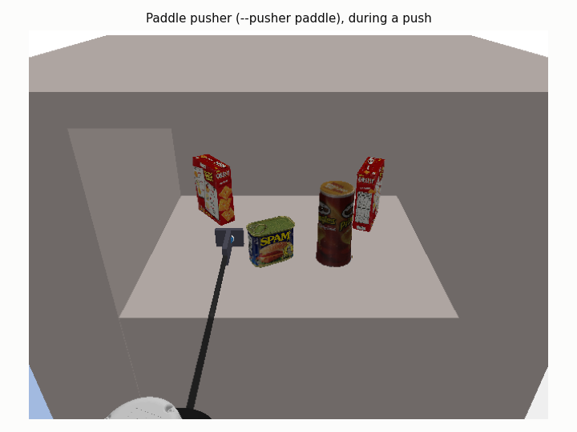

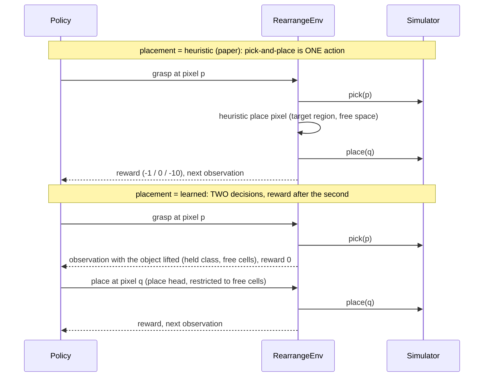

The pick is bootstrapped from the best place value without discount (one pick-and-place counts as one decision). Pushing is not a "fallback":
it exposes occluded objects, moves several objects at once and finishes objects that are one push from their region.

---

## Training

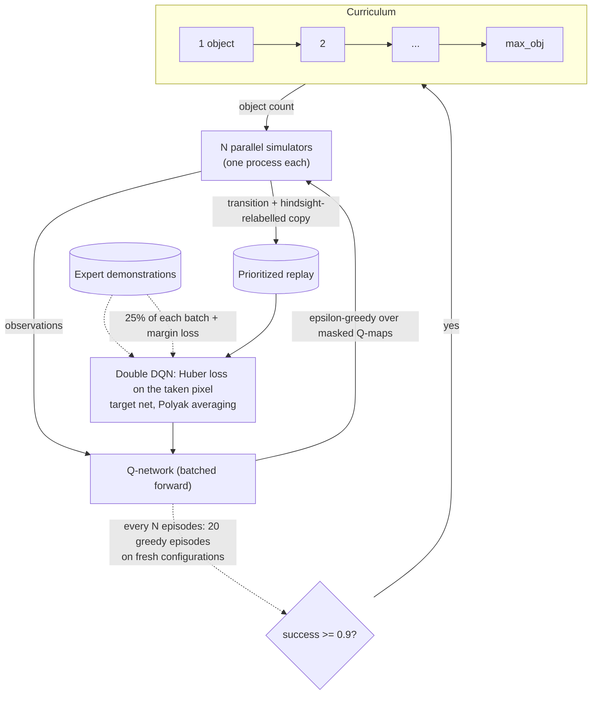

* **Reward** (paper): -1 per action, 0 on the goal, -10 for an invalid state; variants below.
* **Exploration**: epsilon-greedy, `--eps_start` (default 0.8) annealed to `--eps_end` (default 0.01) **at every curriculum stage**,
  over the *masked* maps. Demonstration-initialised agents should start low (`--eps_start 0.2 --eps_end 0.05`).
* **Targets**: one-step double DQN by default; `--n_step N` stores N-step returns (the grasp -> place step stays undiscounted),
  `--twin_q` (object agent) takes the minimum of two value heads.
* **Validation noise**: `--curriculum_window K --success_threshold 0.85` advances on the success pooled over the last K validations;
  `--fixed_validation_seeds` validates a stage on the same scenes every time.
* **Curriculum**: the object count grows when the recent success rate is high. The default rule uses the epsilon-greedy training window
  (as in the paper); `--curriculum_eval 20` instead advances only after a **greedy validation** on 20 fresh random configurations.
  `--stage_mix p` draws earlier stages with probability p to keep easy states in the buffer.
* **Hindsight relabelling** recolours both observations of the transition with the post-hoc class assignment and gives it the goal reward.
* Parallel simulation is the bottleneck (about 1 action/s per process); `--adaptive_step --joint_tolerance 3e-3` cuts the physics steps per
  action by ~2.4x with the same executed fraction (`scripts/speed_ablation.py`).

---

## Variants

Every variant is a flag; they combine. The baseline of the experiment runner is `--placement learned --footprint_placement`.

### Agent and architecture
| flag | variant | what it is |
|---|---|---|
| `--belief none\|spatial\|recurrent` | belief state | memoryless (paper) / a memory map of what was seen (last colour, height, age, last action; +7 input channels) / a ConvGRU latent updated from the encoded observation and action |
| `--placement heuristic\|learned` | placement | rule from the paper / a place head over free cells, conditioned on the held class |
| `--push_lengths 0.04 0.08 0.12` | learned push length | one Q-map per (direction, length) |
| `--hierarchy` | hierarchical agent | level 1 picks the primitive from pooled features; level 2 the pixel and, for pushes, a **continuous length** (DDPG-style actor on a length-conditioned critic) |
| `--backbone hybrid` | transformer | see [The agents and networks](#the-agents-and-networks) |
| `--end_effector suction\|gripper` | tool | suction cup (constraint model) / wide-stroke parallel-jaw gripper (friction, one Q channel per jaw yaw, `--jaw_yaws`) |

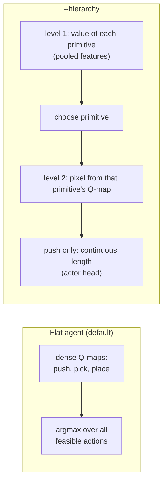

### Observation and perception
| flag | variant |
|---|---|
| `--perception gt` | masks from PyBullet's ground truth |
| `--perception network` | a small U-Net predicts the object **type**; the episode's type -> class specification gives the class (0.96 pixel IoU, top-view instance recall 0.97 on unseen scenes) |
| `--perception agnostic` | an **object-agnostic** U-Net (background / interior / touching-boundary, no type catalogue); instances are connected components of the interior, so it should transfer to unseen object types (`--object_types` holds types out) |

An object's class is part of the task (its target region), not of its appearance, which is why the type network needs the episode specification.
Train and evaluate: `python train_perception.py collect|train|evaluate [--task agnostic]`.

### Rewards, masks, placement
| flag | variant |
|---|---|
| `--reward_mode sparse` | the paper's reward |
| `--reward_mode progress\|distance` | potential-based shaping (policy-invariant) by sorted fraction / by distance to the target region |
| `--reward_mode noop` | sparse + a penalty for actions that moved nothing (changes the optimum) |
| `--reward_mode combined --reward_scale 3 --noop_penalty 0.5` | progress + distance potential, scaled, plus the no-op penalty: a stronger placement signal (+0.6 per sorted object at 5 objects instead of +0.2) |
| `--mask_level basic` | grasp on any object cell, push near objects (original) |
| `--mask_level structured` | grasp only just inside an object's **front face**, push only with an object in the **blade's own strip**: 703 -> 193 grasp cells per scene; a random push moves an object 88% of the time instead of 62% |
| `--footprint_placement` | keep the placement target clear of the back wall by the held object's depth |
| `--placement_space region` | additionally fit the object's whole footprint and offer only cells inside its own target region |

### Demonstrations, DAgger and RL
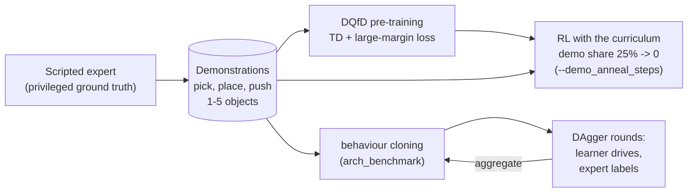
* **DQfD**: `--demos <file> --pretrain_steps 3000` pre-trains on the demonstrations, then 25% of each RL batch comes from them with the
  margin loss on the expert action. That loss pins the policy to the expert; `--demo_anneal_steps N` fades the share to 0 over N RL
  gradient steps so the demonstrations bootstrap the agent without capping it.
* **DAgger** (`scripts/dagger.py --variant <name>`): the learner drives the simulator, the expert labels every visited state, the labels
  are aggregated with the demonstrations and the learner is retrained; the held-out evaluation runs after behaviour cloning and after DAgger.
* Demonstrations recorded with a continuous length (`--hierarchy`) are mapped to the nearest selectable length for agents with discrete
  lengths; the recorded belief is stripped for agents without one (`demos.adapt_demos`).
The expert picks the front-most misplaced object (aiming a few millimetres *inside* it: the cup stops on contact and a front-most
aim often misses), places it by the footprint-aware heuristic, pushes objects that are one push from their region, and pushes a front
object aside when every misplaced object is hidden. A margin loss keeps the network a **Q**-network (plain behaviour-cloning logits
would not be Q-values); a generative policy (diffusion / ACT) is not used: a dense pixel map already represents several equally good picks as several peaks.
`python scripts/collect_demos.py ...` records them, `python train.py --demos data/demos/expert.pkl --pretrain_steps 3000` uses them.

### Simulator
| flag | variant |
|---|---|
| `--sim_quality legacy\|improved\|modern` | IK with joint limits, tared / filtered force contact detection, verified suction grasps; `modern` adds a rate-limited joint controller, more solver iterations, deterministic contacts |
| `--physics paper` | the paper's cabinet dimensions, weaker suction, lighter objects (unvalidated) |
| `--adaptive_step`, `--joint_tolerance`, `--camera_scale`, `--step_distance` | speed options (measured in `SIMULATION_NOTES.md`) |
| `--randomize` | domain randomisation (friction, mass, camera pose, sensor noise) |

---

## Tools and experiments

| tool | use |
|---|---|
| `scripts/run_experiments.py list\|run\|summarize` | named suites (`core`, `belief`, `perception`, `end_effector`, `physics`, `smoke`) x seeds -> `summary.md`; `--max_obj`, `--num_obj`, `--max_episodes`, `--extra <train flags>` |
| `evaluate.py` | greedy evaluation on fixed seeds per object count (success rate, mean actions, return) |
| `profile_sim.py` | where the simulation time goes, executed / attempted actions, force-limit stops |
| `analyze_rewards.py` | the reward signal and scene volatility under random actions |
| `scripts/speed_ablation.py` | physics steps per action and executed fraction for the speed options |
| `scripts/collect_demos.py`, `scripts/merge_demos.py` | record expert demonstrations (in parallel parts) and merge them |
| `scripts/arch_benchmark.py --variants ... --seeds 3 [--rollouts N]` | supervised benchmark of network variants on the demonstrations: held-out primitive / in-class / sensible / exact accuracy, optional closed-loop rollouts |
| `scripts/dagger.py --variant ... --objects 2 5 --eval_objects 4 5` | DAgger with the scripted expert; held-out success after behaviour cloning and after DAgger |
| `scripts/failure_analysis.py --snapshot ... \| --expert -- <run flags>` | greedy episodes on fresh seeds: outcome per episode (sorted / invalid by which primitive and which object / looping / hidden / ...), per-action effects, placement quality, predicted Q vs realised return |
| `scripts/primitive_profile.py`, `scripts/approach_profile.py`, `scripts/grasp_height_sweep.py`, `scripts/place_profile.py` | oracle tests of the primitives: headings, pulls, approach lines, contact height, release tilt / drift of placements |
| `scripts/physics_sanity.py --sim_quality ... --pusher ...` | rest stability, slide-or-tip under pushes vs the rigid-body prediction, contact forces, object speeds |
| `scripts/make_figures.py`, `scripts/make_result_figures.py` | the figures of this README (scene, episode, observation, Q-maps; learning curves, failures, overestimation, primitives) |
| `tests/sim_scenario.py record\|check` | deterministic scripted scenario on the real simulator (golden results for refactoring) |

Tests: `pytest -q` (the real-simulator regression runs with `L2R_GOLDEN=1`); lint: `ruff check .`.

---

## Status and results

Simulation results (PyBullet). The numbers measure where the system stands; none of the agents is trained to convergence.

**Architecture (supervised on expert demonstrations, held-out accuracy of the chosen cell, 3 seeds).** The U-Net decoder with a
ConvNeXt encoder is the best dense network (0.83 in-class against 0.35 for the original hourglass, 0.75 with plain skips); pyramid
pooling is as good with the residual encoder (0.80); FPN, attention-gated skips and HRNet do worse. The object-centric agent matches
the dense ConvNeXt network in closed loop with about 1 % of its parameters.

**Closed loop.** Behaviour cloning and DAgger with the scripted expert reach about the expert's own level (0.7-0.8 of 4-object scenes,
0.6-0.7 of 5-object scenes). RL with the curriculum (1 -> 10 objects, initialised from the demonstrations) holds that level and the
dense agent reaches 6 objects, but no configuration improves clearly beyond the expert yet.

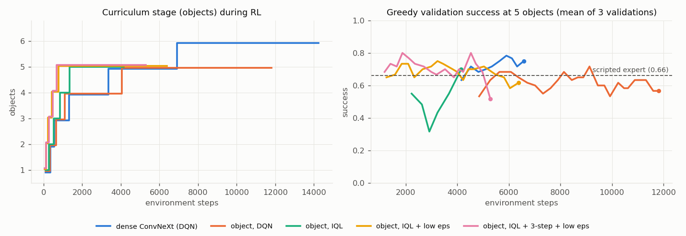

**Current configurations**

| | recommended flags |
|---|---|
| dense agent | `--arch_skips --arch_encoder convnext --push_lengths 0.04 0.08 0.12 --belief spatial --placement learned --footprint_placement` |
| object agent | `--agent object --hierarchy --object_algo iql --twin_q --n_step 3 --belief spatial --placement learned --footprint_placement` |
| training | `--demos <file> --pretrain_steps 3000 --curriculum_eval 20 --curriculum_window 3 --success_threshold 0.85 --eps_start 0.2 --eps_end 0.05 --reward_mode combined --reward_scale 3` |
| primitives | `--grasp_approach clear --place_corridor --pusher paddle`, with `--sim_quality modern` (being validated) |

**In progress:** choosing the primitive set under `modern` physics with the scripted expert, then new demonstrations and retraining
from them; goal masks and goal tokens for arbitrary target areas; the task library (UR and Franka, parallel and vacuum grippers).

Snapshots saved by older versions of this code are not compatible with the current networks.
